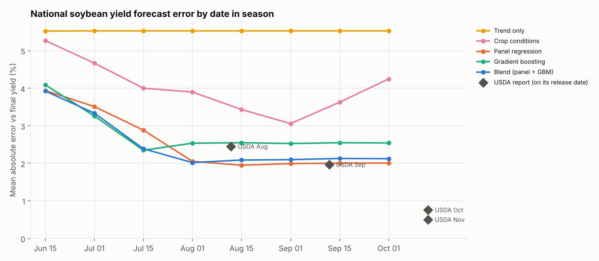
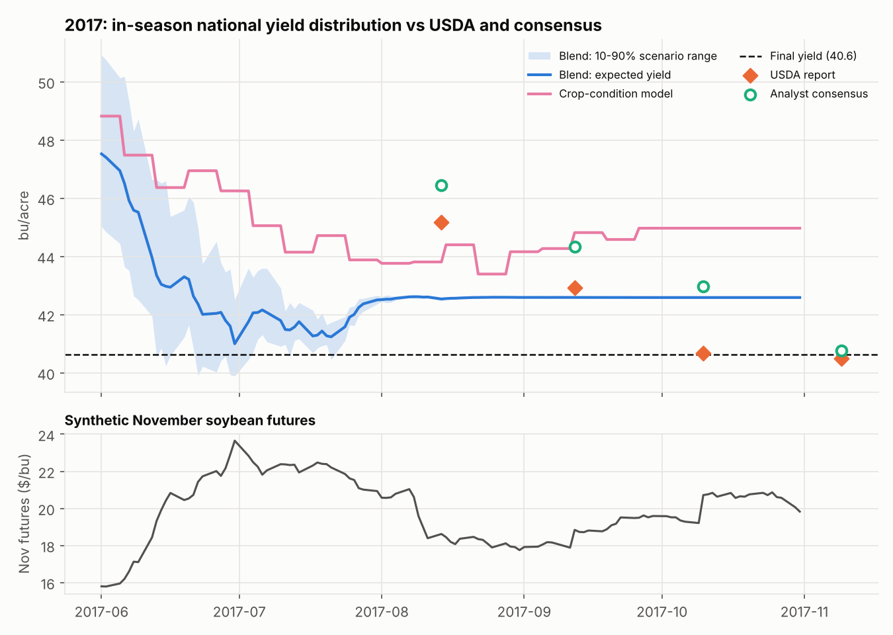
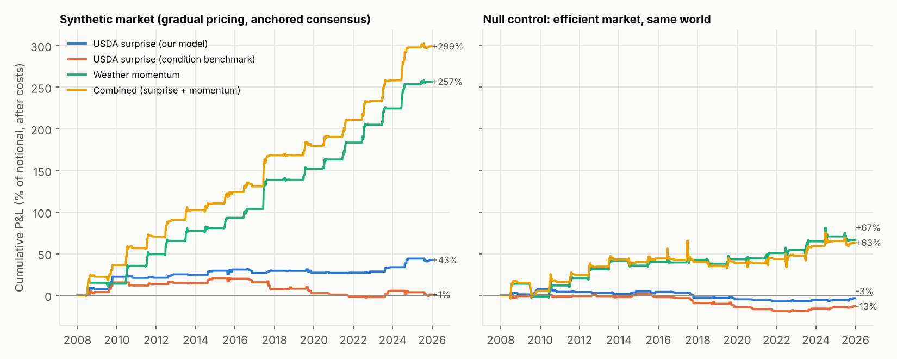
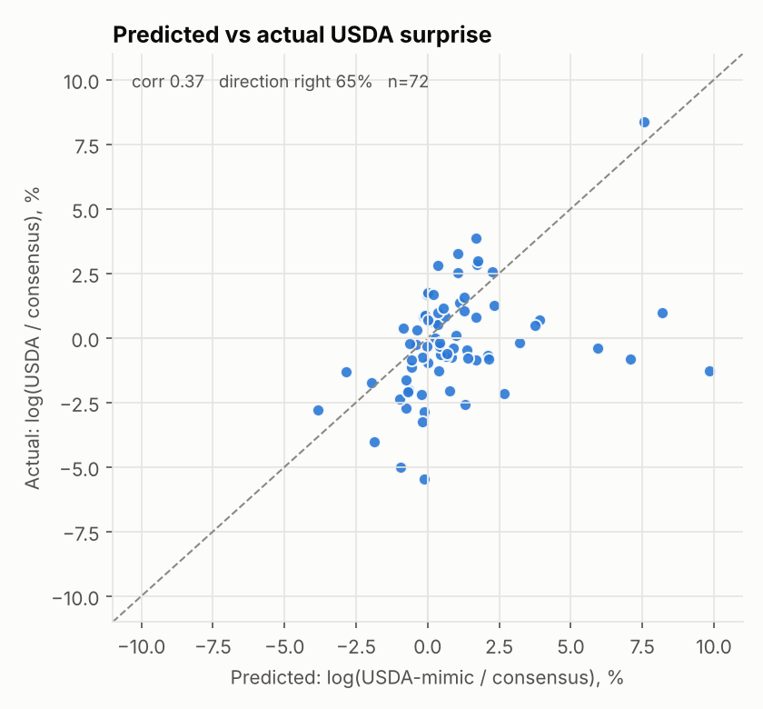
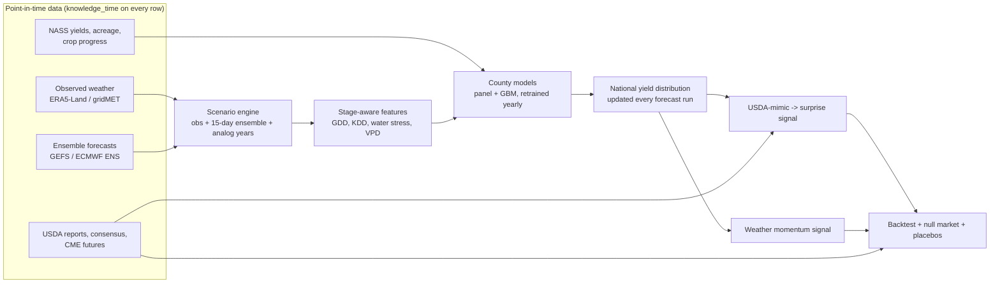

# Weather → Yield → Price

**A point-in-time research pipeline for soybean futures: in-season yield distributions from weather ensembles, a USDA-surprise signal and a weather-momentum signal, tested against an efficient-market null.**

Everything runs on a synthetic but internally consistent world (weather, crop
physiology, USDA reports, analyst consensus, futures). Every synthetic table
mirrors a real dataset, including **when it becomes public**
([docs/DATA_SOURCES.md](docs/DATA_SOURCES.md)), so switching to real data
means implementing the adapters in `src/agriyield/data/sources.py`. Nothing
else changes.

> The numbers below validate the *pipeline* on synthetic data. They are not a
> claim about live CBOT returns. How large the edge is depends on how
> inefficient the market is assumed to be, and that is a config parameter.
> The point is that the system captures an edge when one exists, and finds
> none when it doesn't.

---

## The thesis

A county-level yield model is table stakes: every ag desk and data vendor has
one. The edge is in what you wrap around it:

1. **Forecast the USDA print, not the crop.** Prices react to *USDA minus
   consensus*. Early-season USDA numbers lean toward trend and analysts
   anchor on the last report, so a good weather model plus a "USDA-mimic"
   layer predicts the surprise.
2. **Price every forecast run.** Turn each new ensemble forecast into a full
   distribution of national yield and trade the *change*, before the market
   has fully absorbed it.
3. **Be point-in-time or be wrong.** Revised yields, reanalysis weather and
   report timing are the classic sources of fake backtest Sharpe.
4. **Prove it with a null.** The same world, with an efficient market, must
   give ~0.

## Results (walk-forward, test years 2008-2025)

Models are retrained every year on data public at the time. No parameter
was tuned on this world: momentum settings were chosen on a separate small
development world (`--quick`).

### Forecast skill



* Weather models cut national error from **5.5%** (trend) to **~2.0%** by
  1 August, ahead of USDA's August report (2.45%) and well ahead of the
  crop-condition model every desk runs (3.9%).
* County level, end of season: log-yield RMSE **6.5%** (blend) vs 12.0% (trend).
* Honest note: gradient boosting wins early in the season but the panel model
  is better from August on. The blend is the robust choice.

### The season engine in action: 2017 (worst test year)



By early July the scenario distribution already points to a short crop.
USDA's August number (45.2) and the consensus (46.5) are still anchored near
trend. Final yield: 40.6.

### Trading



| Sleeve (3 bp/turnover costs) | Sharpe | Ann. return | Max DD | Up years | Null-market Sharpe |
|---|---:|---:|---:|---:|---:|
| USDA surprise, our model | **0.52** | 2.3% | -4.8% | 11/18 | -0.09 |
| USDA surprise, crop-condition benchmark | 0.01 | 0.1% | -23.6% | 7/18 | -0.29 |
| Weather momentum | **2.05** | 13.8% | -8.6% | 17/18 | 0.32 |
| Combined | **2.01** | 16.1% | -6.8% | 17/18 | 0.29 |

* Placebo p-values: **0.007** (surprise, random trade directions) and **<0.003**
  (momentum, misaligned positions).
* Predicted vs actual USDA surprise: correlation **0.37** (benchmark 0.12),
  direction right 65% of the time (72 reports).
* On the efficient null market, every sleeve's Sharpe falls to between -0.3
  and +0.3. The residual +0.3 on momentum is an imperfection of the null
  (its drift correction is linear), and it is reported rather than hidden.



Full tables: [reports/RESULTS.md](reports/RESULTS.md) · machine-readable: `reports/metrics.json`.

## How it works



| Step | Module | What it does |
|---|---|---|
| Synthetic world | `synthetic/` | Weather with persistent regimes, soybean phenology, soil water, a hidden yield function with heat x drought interaction, USDA/consensus/market behaviour |
| Point-in-time store | `data/store.py` | Serves only rows whose `knowledge_time` has passed; latest vintage per key |
| Agronomy | `agronomy.py` | Single-sine degree days, Hargreaves ET0, bucket water balance, GDD-driven stages, stage-window features |
| Models | `models/` | Trend + fixed effects, Schlenker-Roberts panel, GBM on residuals, blend, crop-condition benchmark |
| Scenario engine | `forecast/` | Observed-to-date + ensemble + analog tail → 15-member national yield distribution |
| Walk-forward | `validation/` | Yearly retraining as of 31 May; daily in-season runs |
| Signals | `signals/` | USDA-mimic ridge layer + surprise; weather momentum |
| Backtest | `backtest/` | Costs, full-calendar Sharpe, placebo tests |

Method details, every assumption, and the three bugs the null market caught
during development: [docs/METHODOLOGY.md](docs/METHODOLOGY.md).

## Quickstart

```bash
git clone <this repo> && cd agri-weather-yield-alpha
pip install -e ".[dev]"

pytest -q                          # 23 tests incl. look-ahead traps (~15 s)
python -m agriyield run --quick    # small world, a few minutes
python -m agriyield run            # full experiment (~20 min first run, cached after)
```

Outputs land in `reports/`: figures, `RESULTS.md`, `metrics.json`, in-season
forecasts and the trade list as CSV. Every parameter of the world, the models
and the backtest lives in `configs/default.yaml`.

Experiments worth running:

* make the market efficient (`market.adjustment_speed: 1.0`, `usda_anchor: 0.0`)
  and watch the edge disappear;
* make USDA unbiased (`usda.weather_loading: [1,1,1,1]`) and see what happens
  to the surprise sleeve;
* swap the models or add features; skill and P&L are re-measured walk-forward.

## Going live: what changes

1. Implement the adapters in `data/sources.py` (NASS Quick Stats, ERA5-Land /
   gridMET, GEFS from AWS Open Data, ECMWF ENS, CME settlements, consensus
   feed). Archive every forecast run and every report vintage as it lands.
2. Aggregate gridded weather to counties with Cropland Data Layer weights.
3. Replace the synthetic market with real ZSX settlements. The null-market
   test then becomes out-of-sample performance plus placebos.
4. Extensions in order of expected value: hourly temperatures; SIF / NDVI
   satellite features; seasonal outlooks (SEAS5) for the tail beyond day 15;
   Brazil and Argentina (CONAB, Bolsa de Cereales); spread trades (crush,
   soy/corn) instead of outright price.

## Repository layout

```
configs/default.yaml        all parameters
docs/DATA_SOURCES.md        synthetic table -> real dataset, access, release times
docs/METHODOLOGY.md         design, assumptions, limitations
src/agriyield/
  agronomy.py               crop-weather science (shared)
  synthetic/                world generator (geography, weather, truth, market)
  data/                     point-in-time store, source interfaces + real adapters
  features/  models/  forecast/  validation/  signals/  backtest/  reporting/
  pipeline.py, __main__.py  end-to-end run / CLI
tests/                      agronomy, point-in-time, world, pipeline
reports/                    generated results
```

## License

MIT
