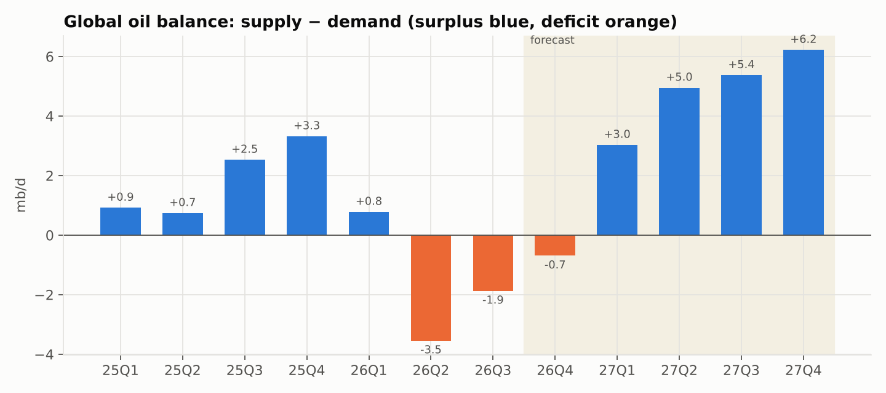
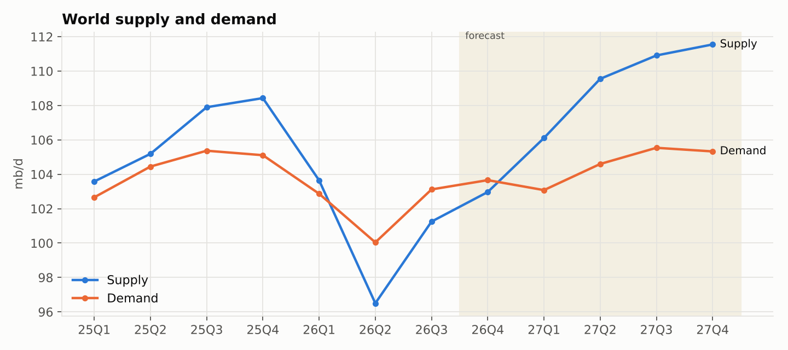
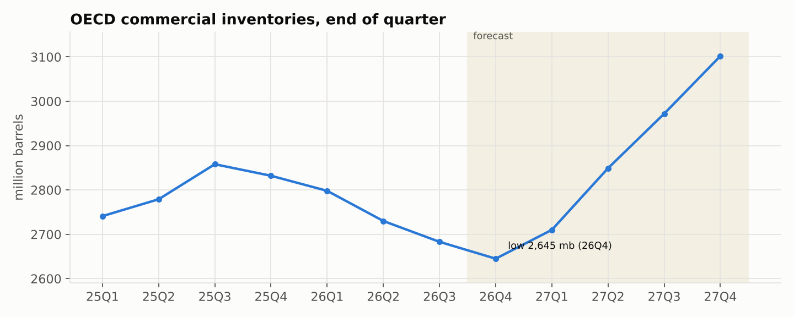
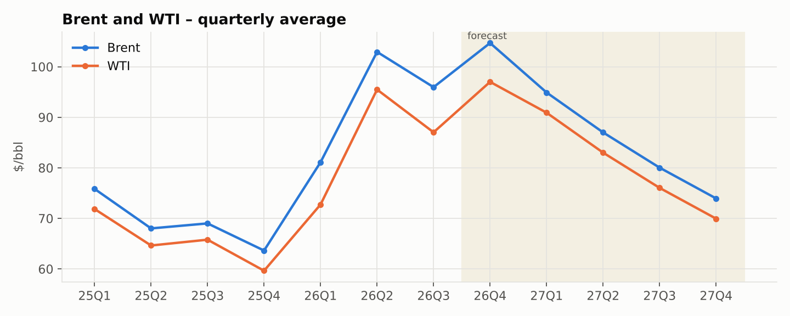
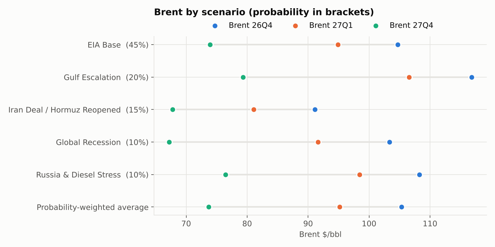
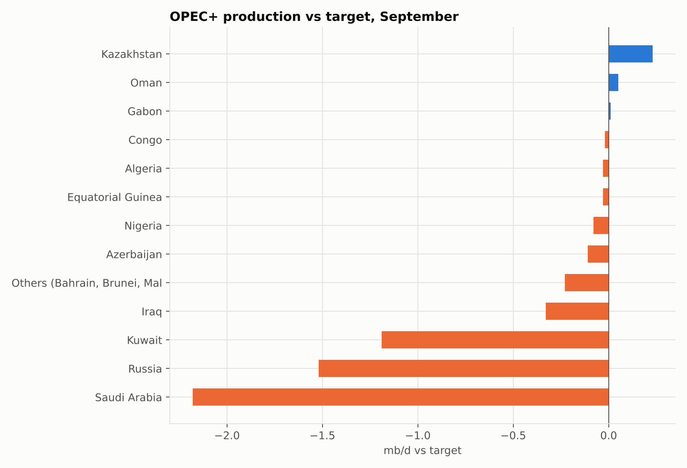
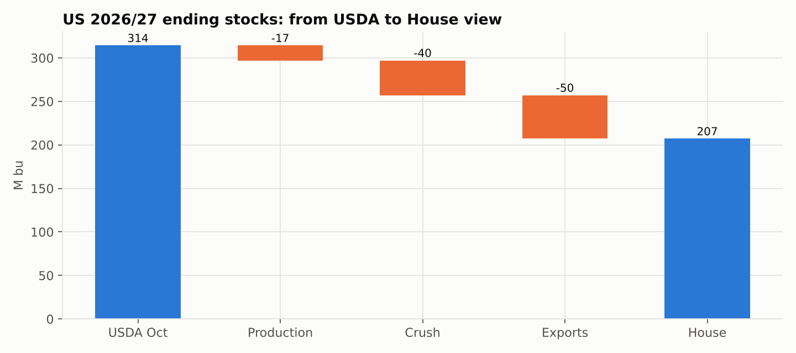
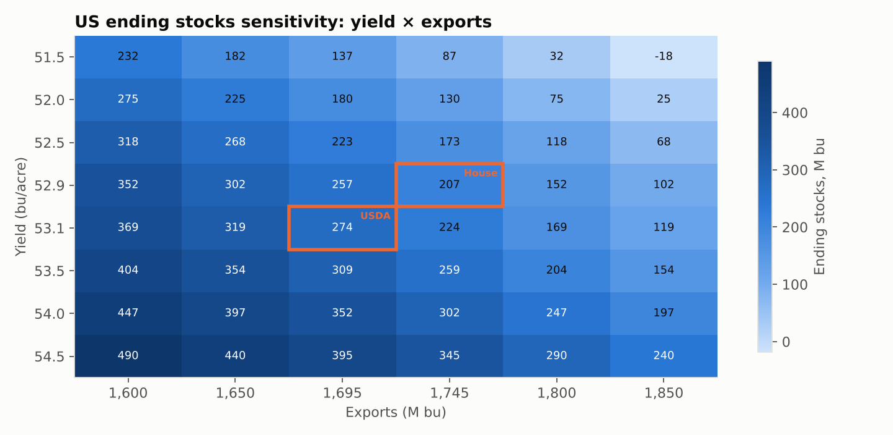
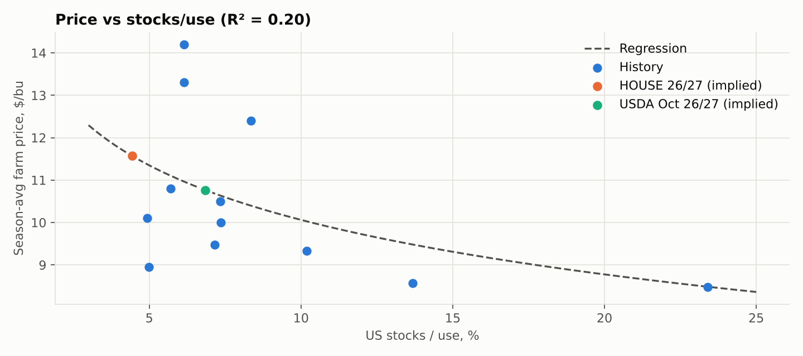
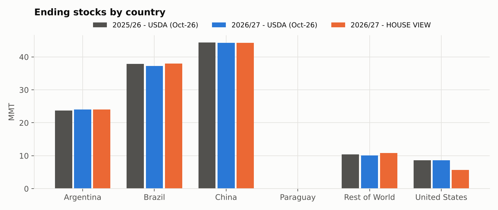

# S&D report – 2026-10-20

_Generated automatically 2026-10-20 09:54 UTC. Full report: `report.html`._

## Crude oil – global balance
_Updated October 14, 2026 · data: EIA Short-Term Energy Outlook October 2026 (tables 2 and 3a), IEA OMR October 2026_

| Balance 2026 | Balance 2027 | OECD stocks trough (26Q4) | Brent 26Q4 (EIA) | Brent 26Q4 prob.-weighted |
|---|---|---|---|---|
| -1.33 mb/d | +4.90 mb/d | 2,645 mb | 104.7 $/bbl | 105.3 $/bbl |

- Active scenario in the workbook: **EIA Base**. Forecast quarters start at 26Q4.
- The market is in deficit in 2026 (-1.33 mb/d) and swings to a surplus of +4.90 mb/d in 2027; the first forecast surplus quarter is **27Q1**.
- OECD commercial stocks bottom at 2,645 mb in 26Q4, then rebuild to 3,102 mb by 27Q4 (+457 mb).
- Brent peaks at $104.7 in 26Q4 and falls to $73.9 by 27Q4 as inventories rebuild. WTI–Brent spread in 26Q4: $7.7.
- Scenarios put 26Q4 Brent between $91.1 (Iran Deal / Hormuz Reopened) and $116.8 (Gulf Escalation); the probability-weighted value is $105.3, +0.6 $/bbl vs the EIA base.
- Largest EIA–IEA gap: Supply 2027 (+1.15 mb/d).
- OPEC+: biggest m/m move is Saudi Arabia (+2.33 mb/d, 8.30 mb/d in Sep-26).
- Last US weekly crude report (2026-10-02): -3.19 mb vs +1.70 expected – Draw vs consensus → bullish.

**Changes since previous run**

_First run: nothing to compare yet._

## Soybeans – US & world balance 2026/27
_Global soybean supply & demand model | As of 13-Oct-2026 (post 9-Oct WASDE) | Units: US in million bushels, world in million metric tons_

| US ending stocks – House | US ending stocks – USDA Oct | US stocks/use House vs USDA | Implied SAFP House – USDA | Board crush margin |
|---|---|---|---|---|
| 207 M bu | 314 M bu | 4.4% / 6.9%  | +0.81 $/bu | 2.47 $/bu |

- House US 2026/27 carryout is **207 M bu** vs USDA's 314 (-107), stocks/use 4.4% vs 6.9%.
- Differences vs USDA come from: yield -0.2, production -17.2, crush +40.0, exports +50.0.
- The S/U regression implies a farm price of $11.57/bu (House) vs $10.76 (USDA balance), +0.81 $/bu. R² is 0.20: use the change, not the level.
- World ending stocks 122.7 MMT (House) vs 124.3 (USDA), -1.57 MMT; exporter stocks/use 18.3%.
- Board crush margin $2.47/bu (above the $2 'run at capacity' level); oil is 50% of product value.
- Nov-26 / Jan-27: 17.0c carry = 81% of full carry (neutral).
- Jan-27 / Mar-27: 10.0c carry = 49% of full carry (tight).
- Sensitivity: 1 bu/acre of yield ≈ 86 M bu of ending stocks.

**Changes since previous run**

_First run: nothing to compare yet._

